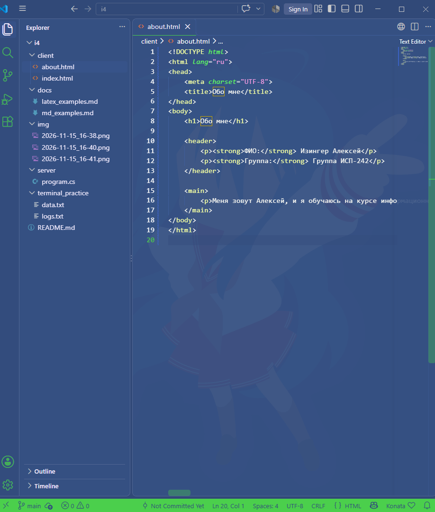
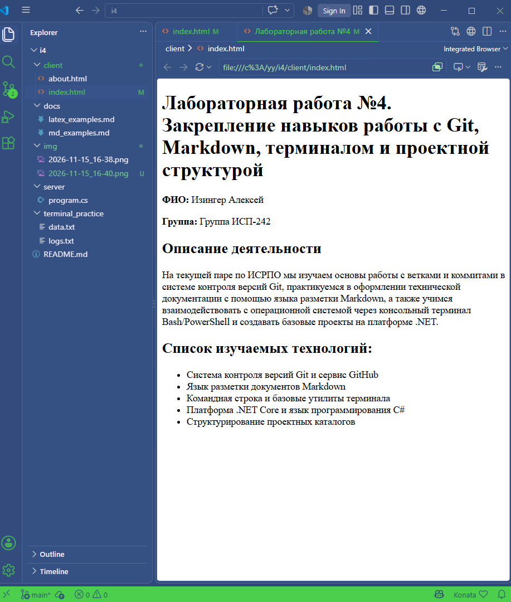

# Лабораторная работа №4

**Выполнил:** Изингер Алексей  
**Группа:** Группа ИСП-242


---

## Описание проекта
Данный репозиторий содержит материалы лабораторной работы №4, посвященной закреплению практических навыков работы с консольным терминалом, утилитой контроля версий Git, компилятором командной строки .NET Core и составлению документации на языке разметки Markdown.

---

## Содержание
1. [Структура проекта](#структура-проекта)
2. [Примеры Markdown](#примеры-markdown)
3. [Примеры LaTeX](#примеры-latex)
4. [Скриншоты работы](#скриншоты-работы)
5. [Заключение](#заключение)

---

## Структура проекта
Проект организован по следующей схеме:
```text
i4/
├── client/
│   ├── about.html
│   └── index.html
├── docs/
│   ├── latex_examples.md
│   └── md_examples.md
├── server/
│   └── Program.cs
├── terminal_practice/
│   ├── data/
│   └── logs/
└── README.md
└── img/
```

---

## Примеры Markdown

### Демонстрационный список инструментов
* Терминал Bash
* Компилятор .NET SDK
* Браузер для проверки HTML

### Пример кода инициализации репозитория
```bash
git init
git remote add origin < url >
```

---

## Примеры LaTeX
* **Встроенный (Inline):** Площадь круга вычисляется по формуле $S = \pi r^2$.
* **Блочный (Block):**
$$
f(x) = \int_{-\infty}^{\infty} e^{-x^2} dx
$$


---

## Скриншоты работы








---

## Заключение
В ходе выполнения лабораторной работы были полностью освоены базовые механизмы файловых операций в консоли, правила структурирования программных продуктов, форматирование файлов Markdown и интеграция кода с платформой автоматического отслеживания изменений Git. Все 16 коммитов выполнены успешно в строгом хронологическом порядке.
